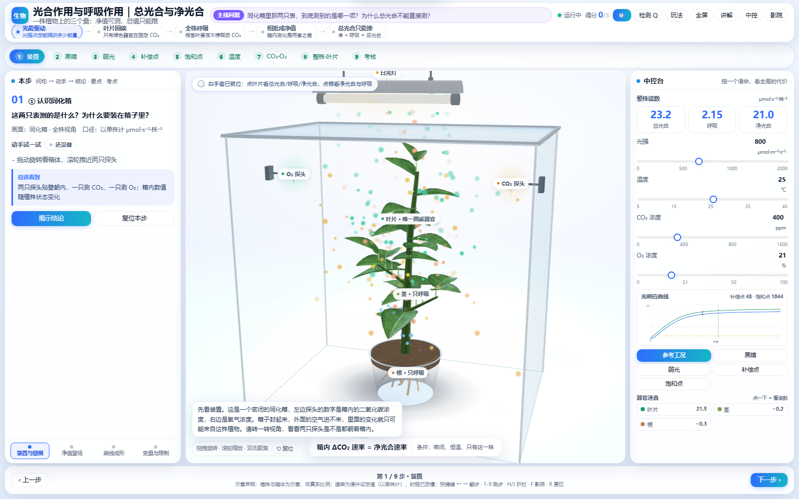

# 光合作用与呼吸作用 · 总光合与净光合（教学驾驶舱 v2）

一株植物上的三个量：**净值可测，总值只能推**。

单文件离线课件，双击 `photosynthesis-cockpit.html` 即可上课，不联网、不装任何东西。
九步走完一节课（1 课时），最后一步是三道随堂考核。



---

## 一、怎么打开

| 方式 | 说明 |
|---|---|
| 双击 | `photosynthesis-cockpit.html`（或 `index.html`，两份内容完全一致） |
| 带参数 | `...html?t=4` 直接进第 5 步；`?voice=0` 静音；`?t=4&voice=0&simple=1` 可组合 |

**离线验证**：断网后双击打开，画面、语音、点选、考核全部可用（three.js r149 已全量内联，无任何外链）。
**联网预览**：同一份文件在浏览器里打开效果相同——本课件没有"联网才能用"的功能。这两件事分开说，是因为"CDN 能加载"从来不能证明离线可用。

## 二、九步走位

| # | 步骤 | 光强 | 温度 | CO₂ | O₂ | 总光合 | 呼吸 | 净光合 |
| --- | --- | --- | --- | --- | --- | --- | --- | --- |
| 1 | 装置 | 800 | 25 | 400 | 21% | 23.2 | 2.15 | 21.0 |
| 2 | 黑暗 | 0 | 25 | 400 | 21% | 0.0 | 2.15 | −2.1 |
| 3 | 弱光 | 30 | 25 | 400 | 21% | 1.5 | 2.15 | −0.7 |
| 4 | 补偿点 | 43 | 25 | 400 | 21% | 2.1 | 2.15 | 0.0 |
| 5 | 饱和点 | 1128 | 25 | 400 | 21% | 24.5 | 2.15 | 22.4 |
| 6 | 温度 | 800 | 35 | 400 | 21% | 21.4 | 4.30 | 17.1 |
| 7 | CO₂·O₂ | 800 | 25 | 1000 | 21% | 28.9 | 2.15 | 26.8 |
| 8 | 整株·叶片 | 800 | 25 | 400 | 21% | 23.2 | 2.15 | 21.0 |
| 9 | 考核 | 800 | 25 | 400 | 21% | 23.2 | 2.15 | 21.0 |

速率单位 **μmol·s⁻¹·株⁻¹**（以单株计），光强单位 **μmol·m⁻²·s⁻¹**。
25 ℃、400 ppm、21% O₂ 下：光补偿点 ≈ **43**，光饱和点 ≈ **1044**。

这张表由 `tools/gen-data.mjs` 现算生成，与课件里的读数、右栏曲线同源，不可能不一致。

## 三、课堂上的四个动作

1. **下一步**（`→` 或 `Space`）：切步会换机位、换左栏脚本、换右栏读数。
2. **拖一个滑块**：光强 / 温度 / CO₂ / O₂ 四个变量实时改变 3D 与读数，曲线上的工况点跟着走。
3. **白手套**：鼠标移进中间画面就变成卡通白手套；**点叶片**弹读数卡（总光合 / 呼吸 / 净光合三者关系），**点根或茎**弹"只有呼吸"的对照卡。两张卡相加，正好等于右栏的整株读数。
4. **揭示结论**：左栏按钮（或 `Enter`）把结论、要点、考点、易错点摊开。

键盘：`← →` 翻步 · `1-9` 跳步 · `H` 折左栏 · `J` 折右栏 · `F` 影院模式 · `Shift+F` 浏览器全屏 · `R` 复位视角 · `Q` 打开考核 · `Esc` 退出影院/关卡。

## 四、三个刻意的设计决定

**① 器官级口径闭合。**
叶片呼吸占比 0.78、茎 0.07、根 0.15，三者之和恰为 1.00，于是
`叶净 + 茎净 + 根净 ≡ 整株净光合`、`叶呼吸 + 茎呼吸 + 根呼吸 ≡ 整株呼吸`。
第⑧步那道"整株 ≠ 叶片"的加法题，靠的是这个恒等式，不是靠嘴说。

**② 单一数据源。**
`tools/model.mjs` 是唯一的公式来源，同时导出三处：`courseware-data.json`（课件内联）、
`README-table.md`（上表）、`src/10-model.js`（浏览器运行时）。HTML 与校验脚本里都没有第二份公式。

**③ 没有后期泛光。**
上一版用 HDR + 泛光做质感；这一版是浅色玻璃主题，泛光只会把白底糊成雾，
于是直接渲到 CSS 的浅蓝渐变上，省掉整条 RT 链路，教室里的核显笔记本更稳。

## 五、简化声明（请对学生说明）

1. 植株、箱体、细胞器均为示意，**非真实比例**；
2. 速率为课件设定值，以单株计，不是实测数据；
3. 颜色只用于区分物质来源与器官，不代表真实光谱或浓度；
4. 光呼吸与叶片内部结构简化为单一系数，只表达"O₂ 升高抑制总光合"这一趋势；
5. 器官呼吸占比 0.78 / 0.07 / 0.15 为设定值，用于让"各器官净光合之和 = 整株净光合"严格闭合。

## 六、文件清单

```
photosynthesis-cockpit.html   成品（单文件，0.75 MB）
index.html                    同一份副本（GitHub Pages 与自检脚本都认这个名字）
libs/three.min.js             打包用的 three.js r149（构建时内联，不参与运行）
src/                          模板、样式、11 个脚本分片
tools/model.mjs               生理模型（唯一公式来源）
tools/gen-data.mjs            数据生成器
build.py                      打包：src + 数据 + three → 单文件
shot.py / uitest.py           headless 出图与交互验收
README-table.md               步骤数量自检表（生成物）
01-spec.md                    开写之前锁定的讲稿规格
```

## 七、已知限制

- **旁白**用系统 TTS（`speechSynthesis`），音色取决于这台机器装了什么中文语音；
  没有中文语音时自动降级为字幕，不影响讲课。这是本课件声明 `voiceMode: optional` 的唯一原因。
- **影院模式**下只剩顶部胶囊和底部视角条，读数与滑块不可见——投影讲实验时用，讲读数时按 `F` 回来。
- 极低端集显（无 WebGL2）会退到软件渲染，前 90 帧平均超过 26 ms 时自动关掉毛玻璃。

## 八、出处

- 教材依据：人教版 2019 · 必修1 第5章第3、4节
- 设计语言参考 [铜匠实验室](https://lab.tongjiang.app)（CC BY-NC 4.0）：**只借鉴布局、配色与组件语言**，
  代码、素材、文案均为自研，未复制其课件内容。
- 3D 部分：three.js r149（MIT）；植株为程序化建模，无外部模型与贴图。
